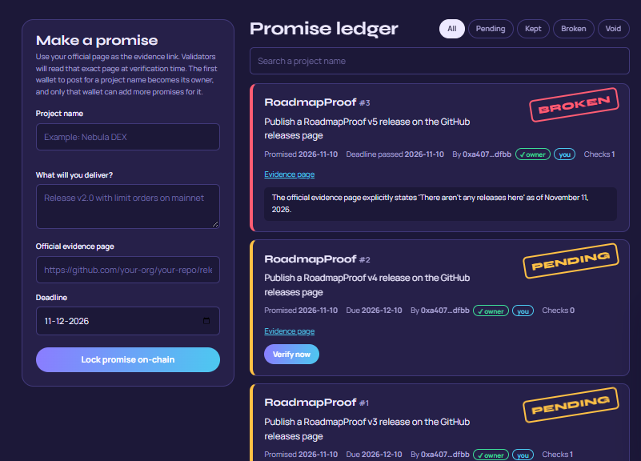
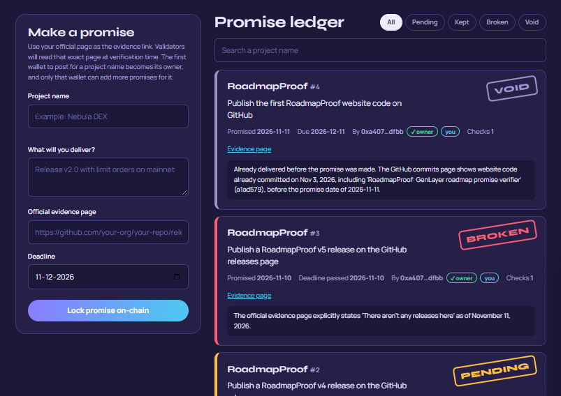

# RoadmapProof v2

**On-chain accountability for crypto roadmap promises, judged by GenLayer validators.**

## What's new in v2 (fixes from community reviews)

Two community reviewers tested v1 in the GenLayer Explorer (4/5 each) and listed real gaps. v2 fixes every one:

| Found in review | v2 fix |
|---|---|
| Anyone could register a promise for any project name, so the Trust Score was gameable. | **Project ownership.** The first wallet to claim a name owns it (`claim_project`, or automatically on its first promise). Only the owner wallet can add promises. Names are matched case- and punctuation-insensitively (`Nebula DEX` = `nebula-dex`). Owners can hand a project to a new team wallet with `transfer_project`. |
| A promise for something already released (Python 3.14, shipped Oct 2025) resolved KEPT straight away. `created_at` was stored but never passed to the judge. | **Promise date sent to the judge.** The prompt now includes `PROMISE MADE ON`. If the page shows the item was released before that date, the verdict is `ALREADY_DONE` and the promise becomes **VOID**, which never counts toward the Trust Score. |
| Python 3.14 was recorded twice as two separate KEPT promises. | **Duplicate guard.** The same project + same claim (ignoring case, spacing and punctuation) is rejected with the id of the existing promise. |
| No BROKEN case proven live yet. | **Proven live on v2:** promise #3 resolved **BROKEN** after its deadline passed (see *Live proof* below). |
| The repo had no tests. | **19 unit tests** in `tests/test_roadmap_proof.py`, run with plain Python. |
| The deployed contract looked different from the repo HEAD. | v2 is deployed from this exact `contracts/roadmap_proof.py`. Anyone can call `get_version()` on the explorer; it returns `2.0.0`. |

The website also checks ownership and duplicates before sending a transaction, shows the owner wallet on every promise and on the Trust Score board, and has a **Void** filter.

## The problem

Crypto teams announce dates all the time: "mainnet in Q3", "v2 by December", "mobile app next month". Holders buy on those promises. When the date passes and nothing ships, the team goes quiet, posts get deleted, and there is no neutral record of who delivered and who did not. Today the only "verification" is someone on X saying so — and they may be paid, biased or wrong.

## What RoadmapProof does

1. **Lock.** A team registers a promise: what it will deliver, a deadline, and the **official page** where proof will appear (GitHub releases, changelog, blog, docs). The team's wallet owns the project name, so nobody else can post promises for it.
2. **Read.** Anyone presses **Verify**. Every GenLayer validator opens that live page itself with `gl.nondet.web.render`.
3. **Agree.** An LLM judge on each validator decides `DELIVERED`, `NOT_DELIVERED` or `UNCLEAR`. Through `gl.eq_principle.prompt_comparative` the validators must reach the same verdict — no single model, server or admin decides.
4. **Settle.**
   - Delivered after the promise was made → status **KEPT**.
   - Already delivered before the promise was made → status **VOID** (no credit).
   - Not delivered and the deadline has passed → status **BROKEN**.
   - Not delivered but the deadline is still open, or the page is unclear → stays **PENDING** with the latest reason recorded. Anyone can check again later.
5. Every project earns a public **Trust Score** (kept ÷ (kept + broken)) from its history. VOID promises are never counted.

### Why GenLayer is required

A normal smart contract cannot read a website or understand whether "v2.0 with limit orders" was actually released. A centralized oracle could, but then you trust that oracle. RoadmapProof needs both **live web data** and **judgment**, agreed by independent validators — exactly what Intelligent Contracts provide.

## Project structure

```
RoadmapProof/
├── contracts/roadmap_proof.py   # Intelligent Contract
├── tests/test_roadmap_proof.py  # 19 unit tests (plain Python)
├── index.html                   # Frontend (single page)
├── app.js                       # genlayer-js wiring + transaction lifecycle UI
└── README.md
```

## Contract methods

| Method | Type | What it does |
|---|---|---|
| `claim_project(project, website)` | write | Claims a project name for the sender wallet. `website` may be empty or an https link. |
| `transfer_project(project, new_owner)` | write | Owner only. Hands the project name to another wallet. |
| `create_promise(project, claim, evidence_url, deadline)` | write | Owner only (first post claims the name). Rejects duplicates. Deadline format `YYYY-MM-DD`, today or later (UTC). |
| `verify_promise(promise_id)` | write | Anyone. Validators read the evidence page, judge against the promise date and deadline, reach consensus and settle. |
| `get_promises()` | view | All promises, newest first (JSON). |
| `get_promise(promise_id)` | view | One promise (JSON). |
| `get_project(project)` / `get_projects()` | view | Owner records (JSON). |
| `get_leaderboard()` | view | Trust Score per project with owner and void count (JSON). |
| `get_stats()` | view | Totals: kept, broken, pending, void, projects, validator checks (JSON). |
| `get_version()` | view | `2.0.0` — confirms the deployed code is this repo version. |

Safety details: owner-only promises per project, duplicate guard, input limits on every field, https-only evidence links, deadlines cannot be in the past, the prompt tells the model to ignore instructions inside the page (prompt-injection guard), model output is parsed into a fixed verdict set (`DELIVERED`, `NOT_DELIVERED`, `ALREADY_DONE`, `UNCLEAR`), and a promise cannot be resolved twice.

Known limit: a project name goes to the first wallet that claims it. A future version can let validators confirm the claimer controls the project's official website.

## Tests

```
python tests/test_roadmap_proof.py
```

The test file loads the real contract with a small stand-in for the `genlayer` module, so no node is needed. It covers ownership, name variants, transfer, duplicates, input rules, the promise date in the prompt, VOID, KEPT, BROKEN after the deadline, PENDING before it, bad model output, double resolution and the Trust Score.

## Frontend

- Reads live data from the contract (`readContract`) — stats, ledger, trust scores.
- Sends real transactions (`writeContract`) for creating and verifying promises.
- Shows the **full transaction lifecycle**: signed → pending → validators judging → consensus (accepted) → finalized, and clear messages for failures (undetermined, timeouts).
- Works with a browser key out of the box, or MetaMask on GenLayer Studionet.

## Live deployment

- v2 contract (GenLayer Studionet): [`0xC0e4a345af38F91D286a9b84aB260e109F066f5b`](https://explorer-studio.genlayer.com/address/0xC0e4a345af38F91D286a9b84aB260e109F066f5b)
- Website: https://gurusankar55.github.io/roadmapproof/
- v1 contract (kept for history): [`0x13DCb5fE3EF0D349291fFfCB6F67a5ADDC461c10`](https://explorer-studio.genlayer.com/address/0x13DCb5fE3EF0D349291fFfCB6F67a5ADDC461c10)

### Live proof on the v2 contract

Real transactions on the v2 contract, verified by GenLayer validators from the live evidence pages:

| # | Promise | Deadline | Verdict | What the validators found |
|---|---|---|---|---|
| 3 | Publish a RoadmapProof v5 release on the GitHub releases page | 2026-11-10 | **BROKEN** | Checked on Nov 11, after the deadline: the releases page says "There aren't any releases here". |
| 4 | Publish the first RoadmapProof website code on GitHub | 2026-12-11 | **VOID** | The commits page shows the code was already committed on Nov 3, 2026, before the promise date (Nov 11). Already-done work earns no Trust Score. |
| 1 | Publish a RoadmapProof v3 release on the GitHub releases page | 2026-12-10 | **PENDING** | Not delivered yet, deadline still open, so it stays pending instead of being judged early. |

**BROKEN — promise #3 (deadline passed, nothing shipped)**



**VOID — promise #4 (already done before the promise was made)**



Each project's owner wallet is shown with the "owner" badge; only that wallet could post these promises.

## How to run

1. Open [GenLayer Studio](https://studio.genlayer.com), create a new contract, paste `contracts/roadmap_proof.py`, deploy (no constructor arguments). Copy the contract address.
2. Open the website (GitHub Pages link or `index.html` via any static server).
3. Paste the contract address into the yellow box (or set `DEFAULT_CONTRACT` in `app.js`).
4. Create a promise with a real evidence page, for example a GitHub releases page, then press **Verify now**.

### Try it quickly

- **Kept example:** Project `Node.js`, claim `Release Node.js version 22`, evidence `https://github.com/nodejs/node/releases` → validators find the release → **KEPT**.
- **Pending example:** a claim for something not yet on the page with a future deadline → stays **PENDING** with the reason.
- **Void example:** a claim for something released before today (for example a Python version that already shipped) → **VOID**, not counted.
- **Broken example:** set the deadline to today for something that does not exist, then press **Verify now** the next day → **BROKEN**.

## Roadmap for continued use

- GEN bonds: teams lock GEN behind a promise, returned if kept and slashed if broken (when value transfers are available on the target network).

- Telegram / X bot that posts every KEPT or BROKEN verdict.
- Embeddable Trust Score badge for project websites.
- Scheduled automatic verification at each deadline.
- Multiple evidence URLs per promise (GitHub + blog + app store).
